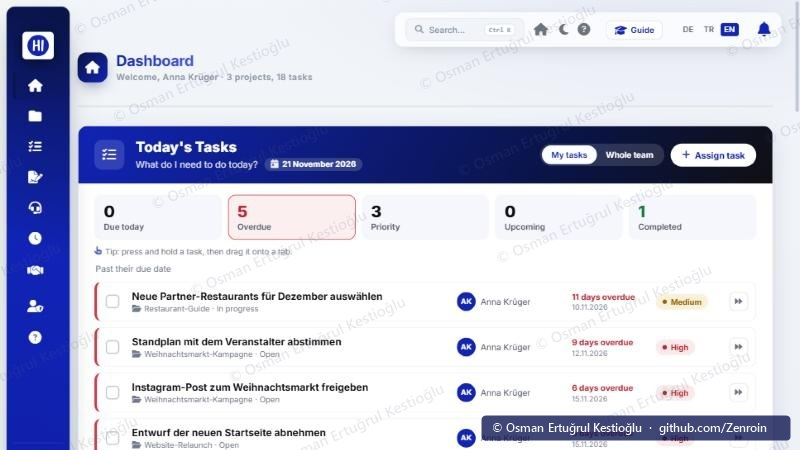
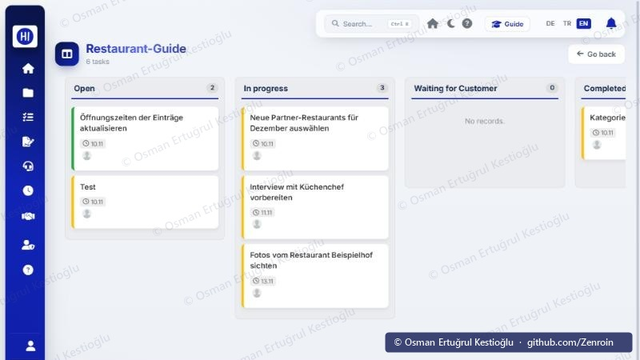
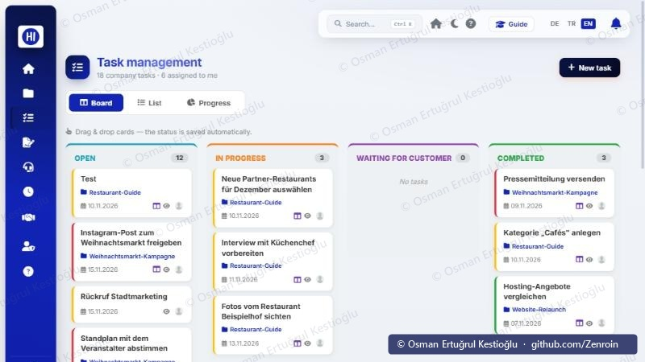
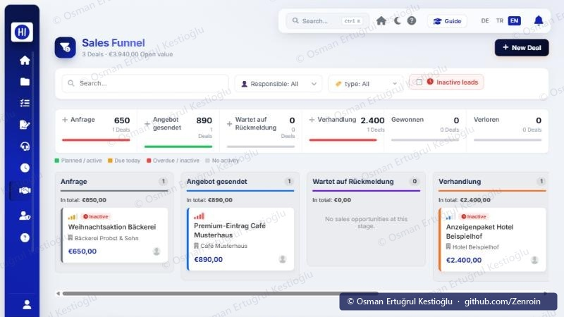
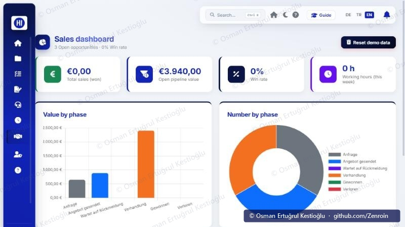
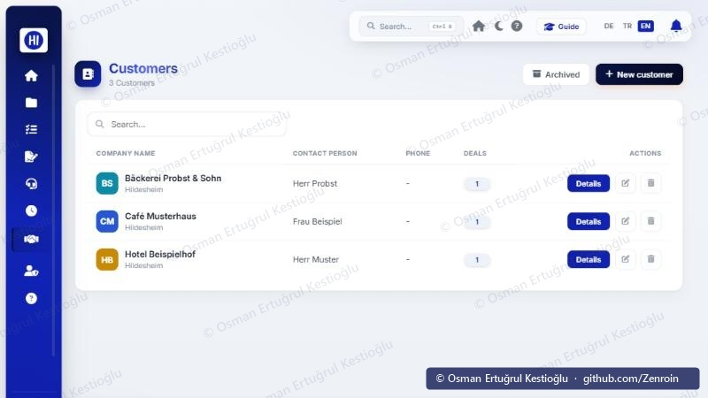
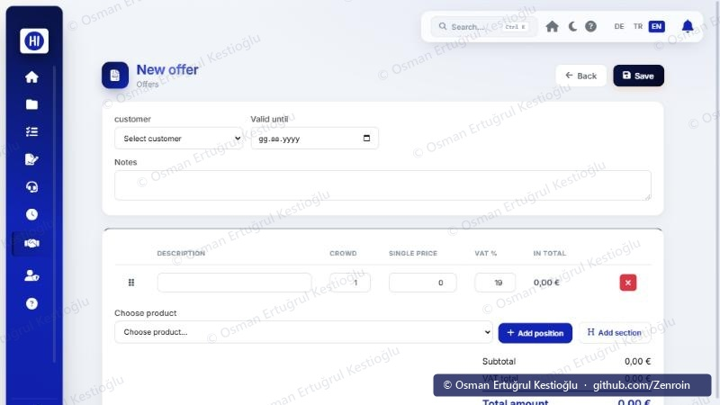
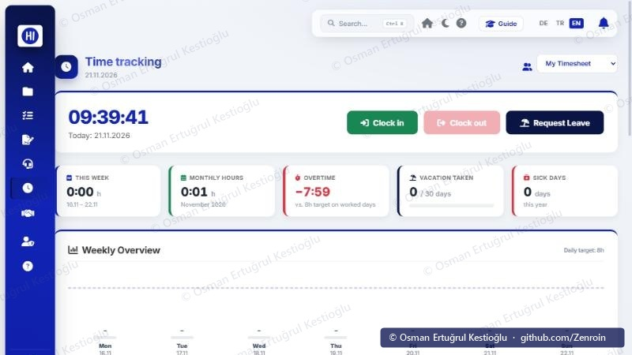

# 🏢 Corporate Management Platform

## 🚀 Overview

A multi-module **Enterprise Operations Management System**, designed and built as a solo freelance project for a company in Germany. It unifies **project delivery**, **CRM & sales**, **HR operations**, **document management**, and **corporate governance** in a single, secure platform.

Built for the **German-speaking market** (default UI: **Deutsch**, plus **Türkçe** and **English**), with EUR-ready CRM, configurable sales pipelines, and GDPR-conscious security practices.

> Screenshots below show the current version with **demo data**.

---

## ✨ Core Modules & Capabilities

### 📊 Executive Dashboard & Analytics

The command center of the application — real-time KPIs and operational visibility.

* **KPI Tracking:** Projects, tasks, users, and open CRM pipeline value at a glance.
* **Bottleneck Prevention:** Overdue and upcoming tasks (project + CRM follow-ups).
* **Activity Feed:** Chronological log of task and project changes.
* **CRM Summary Row:** Pipeline value, unattended leads, link to sales dashboard.

---

### 🚀 Strategic Project Portfolio & Visual Kanban

Seamless transition from portfolio overview to granular project control.

* **Portfolio Management:** All company projects with creator, dates, and quick actions.
* **Project 360° View:** Tasks, documents, team members, and linked CRM deals.
* **Drag-and-Drop Kanban:** Move cards between status columns per project.

---

### ⚡ Advanced Task & Project Lifecycle

Full-scale task management beyond simple to-do lists.

* **Company-wide Task Board:** Board, list, and progress views; status saved automatically on drag & drop.
* **Granular Assignment:** Delegate to users with due dates and priority.
* **Subtasks, Comments & Files:** Collaboration on the task detail page.
* **Status Workflow:** Open → In Progress → Waiting for Customer → Completed.

---

### 🤝 CRM & Sales Pipeline

End-to-end customer relationship and revenue tracking — designed for B2B sales teams.

* **Visual Pipeline:** Kanban-style deal board with configurable stages (e.g. *Anfrage → Angebot → Verhandlung → Gewonnen / Verloren*).
* **Leads & Opportunities:** Type distinction, priority bars, activity health indicators.
* **Customers & Contacts:** 360° customer cards with linked deals and contact persons.
* **Quotes (Angebote):** Create, edit, print PDF-style quotes with line items and VAT.
* **Product Catalog:** Reusable products/services for quotes and deals.
* **Sales Dashboard:** Win rate, pipeline value, rep performance charts.
* **Reports:** Campaign win/loss and team pivot analytics.
* **Integrations:** Web-to-Lead API, UTM capture, automatic lead routing rules.
* **Workflow Automation:** Qualify tasks, won-deal follow-ups, unattended-lead filters.

---

### ⏱️ Time Tracking & Attendance

Operational time recording for payroll and capacity planning.

* **Clock In / Clock Out:** Per-user daily time entries.
* **Leave Requests:** Vacation and sick-day tracking without breaking the timesheet chain.
* **Weekly Overview & Overtime:** Hours vs. daily target, monthly totals.
* **Admin Team View:** See who is currently working (manager overview).

---

### 📁 Secure Document & Asset Hub

Centralized wiki / knowledge base for procedures and project docs.

* **Rich-Text Editor:** Create and edit internal documentation.
* **Search & Favorites:** Fast retrieval across the document library.
* **Role-Based Access:** Visibility tied to user roles and project membership.

---

### 👥 HR & Departmental Tracking

Organizational structure and individual performance.

* **Department Mapping:** Departments with member assignment.
* **Performance Analytics:** Pie charts and metrics per employee.
* **User Management:** Roles (Admin / User), profile, avatar, soft-delete archive.
* **Role Management:** Strict RBAC on pages and API endpoints.

---

### 💬 Internal Support & Ticketing

Cross-department communication without email chaos.

* **Centralized Helpdesk:** Incoming and outgoing ticket queues.
* **Activity Heatmap:** Monthly staff interaction overview.
* **Threaded Replies:** Full conversation history with status updates.

---

### ⚖️ Corporate Governance (Board Resolutions)

Official board decision management.

* **Decision Logging:** Create and publish resolutions to staff.
* **Read Confirmation:** Track who acknowledged each decision.
* **Secure Attachments:** PDF and document storage per resolution.

---

### 🎓 Interactive Onboarding & Help

Users learn the system by doing — not just reading.

* **Guided Tour:** Cross-module walkthrough (projects → tasks → CRM) with demo data cleanup.
* **Per-Page Educator:** Context-sensitive step-by-step guides on every major screen.
* **Help Center:** Structured documentation with links into live modules.
* **Dark Mode:** Full UI theme toggle for long working sessions.

---

## 🔔 Platform Features

| Feature | Description |
|--------|-------------|
| **Notifications** | In-app bell with unread count and mark-as-read |
| **i18n** | German (default), Turkish and English — switchable in the top bar |
| **Responsive UI** | Collapsible sidebar, mobile tables, touch-friendly CRM board |
| **Soft Delete** | Projects, users, CRM records archived — not hard-deleted |
| **Email Verification** | Registration and password-reset flows |

---

## 💻 Technical Architecture & Stack

| Layer | Technology |
|-------|------------|
| **Pattern** | Modular PHP pages + JSON REST-style API layer |
| **Backend** | PHP 8.x, `mysqli` prepared statements |
| **Database** | MySQL 8.x / MariaDB |
| **Frontend** | Vanilla HTML5, CSS3, JavaScript (Fetch API, Sortable.js) |
| **Charts** | Chart.js (dashboard & sales analytics) |
| **Auth** | PHP sessions, `password_hash`, role-based access |
| **Hosting** | Linux VPS, nginx + PHP-FPM, SSH-based releases, cron jobs (SQL backups, e-mail reminders) |

### 🔐 Security Highlights

* CSRF tokens on all mutating API calls and forms
* Object-level authorization checks (IDOR prevention)
* Server-side input validation and prepared statements (SQL injection prevention)
* Rate limiting on login, register, and password reset
* Secure session cookies (`HttpOnly`, `Secure` on HTTPS)
* Upload whitelist (MIME + extension), randomized filenames, no PHP execution in upload dirs
* Security headers (`X-Frame-Options`, `CSP`, `X-Content-Type-Options`)
* Secrets in `config.local.php` (not committed)

---

## 🗂️ Repository Structure

| Repository | Purpose |
|------------|---------|
| **[Zenroin/Project-Management](https://github.com/Zenroin/Project-Management)** *(this repo)* | Public showcase — README, screenshots, capability overview |
| **Zenroin/proje-yonetim** *(private)* | Full source code, API, SQL migrations, deployment config |

> **🔒 Proprietary Notice:** The core source code, API structure, and database schemas are maintained in a **private repository** to protect proprietary business logic. This public repository is a **visual and functional overview** for demos, portfolio, and client evaluation.

---

## 📜 Changelog (high level)

| Version | Highlights |
|---------|------------|
| **2025 Q4** | Core PM: projects, Kanban, tasks, docs, tickets, board resolutions, dark mode |
| **2026 Q1** | CRM module v1–v4: pipeline, quotes, integrations, reports |
| **2026 Q2** | Time tracking, i18n, security hardening, interactive onboarding |
| **2026 Q4** | Refreshed screenshots of the current version |

---

*© Osman Ertuğrul Kestioğlu — All rights reserved. Screenshots are watermarked and may not be reused without permission.*
